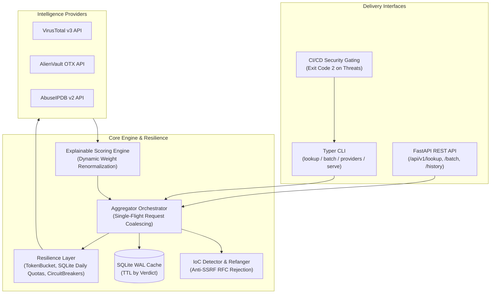

# ThreatLens

[](https://www.python.org/downloads/)
[](file:///c:/Users/HP/Desktop/New%20folder%20%282%29/VERIFICATION.md)
[](https://github.com/astral-sh/ruff)
[](https://mypy-lang.org/)
[](https://github.com/PyCQA/bandit)
[](file:///c:/Users/HP/Desktop/New%20folder%20%282%29/LICENSE)
[](file:///c:/Users/HP/Desktop/New%20folder%20%282%29/Dockerfile)

> **Threat Intelligence Aggregator & CLI** &mdash; Concurrently query, normalize, and score Indicators of Compromise (IoCs) across multiple threat intelligence providers with explainable scoring, multi-tier resilience, and high-performance local caching.

---

## Architecture Overview

ThreatLens unifies disparate threat intelligence sources into a single normalized schema, orchestrating async queries with built-in request coalescing, circuit breakers, and rate limiters.



---

## Key Features

- **Multi-Type IoC Auto-Detection & Refanging**:
  - Automatically identifies IPv4, IPv6, Domains (FQDNs verified against Mozilla Public Suffix List via `tldextract`), URLs, and cryptographic hashes (MD5, SHA1, SHA256).
  - Automatically refangs defanged indicators commonly found in security tickets: `hxxp://`, `hxxps://`, `[.]`, `(.)`, `[dot]`, and `[:]`.
  - **Built-in Anti-SSRF**: Strictly rejects loopback, RFC 1918 private subnets, link-local, and cloud metadata addresses (`169.254.169.254`).
- **Concurrent Provider Fan-Out**:
  - Concurrently queries **VirusTotal v3**, **AlienVault OTX**, and **AbuseIPDB** using async HTTPX.
  - Normalizes heterogeneous responses into unified, validated Pydantic models with zero uncaught provider exceptions.
- **Explainable Scoring Engine**:
  - Transparent non-linear scoring curves (sigmoid VT curve with engine count bonus, logarithmic OTX pulse curve with threat actor bonus, AbuseIPDB confidence damping).
  - **Dynamic Weight Renormalization**: If a provider is skipped or circuit-broken, active provider weights are mathematically renormalized to sum to 1.0.
  - Outputs an audited, human-readable reason per provider alongside categorical verdicts: `clean`, `low_risk`, `suspicious`, `malicious`.
- **Multi-Tier Resilience & Flow Control**:
  - **Token Bucket Limiter**: Smooths requests to match upstream per-minute limits (RPM).
  - **Persistent Daily Quota Tracker**: Persists daily quota usage in SQLite across restarts with UTC midnight rollover.
  - **Three-State Circuit Breakers**: Prevents cascading failures to failing upstreams (`CLOSED` &rarr; `OPEN` &rarr; `HALF-OPEN`).
  - **Exponential Backoff**: Retries with jitter and automated `Retry-After` header parsing.
- **High-Performance Local Caching**:
  - Persistent SQLite cache in Write-Ahead Logging (WAL) mode with variable TTL based on verdict (malicious cached 2h, clean cached 24h).
  - **Request Coalescing (Single-Flight)**: Deduplicates simultaneous in-flight queries for identical indicators using `asyncio.Future` maps, eliminating cache stampedes.
- **Multi-Format Report Generator**:
  - Exports reports in **JSON**, **CSV** (flattened 17-column format ready for SIEM ingest), **Markdown**, and **self-contained HTML dashboards** (dark cybersecurity theme, KPI cards, sortable table via vanilla JS, and search filtering with zero CDN dependencies).
- **Security-First Architecture**:
  - Correlated request tracking (`X-Request-ID`).
  - Automated `SecretRedactionFilter` guarantees API keys never leak into JSON logs.
  - Timing-safe constant-time API key verification (`hmac.compare_digest`).
  - Multi-stage hardened Docker image running as non-root user `threatlens` (UID 10001).

---

## Quickstart

### 1. Installation

Requires Python 3.11+. The project is managed via [uv](https://docs.astral.sh/uv/) or pip.

**Windows (PowerShell):**
```powershell
# Clone the repository
git clone https://github.com/Fantcoder/Threat-Lens.git
cd threatlens

# Install dependencies using the PowerShell task runner
.\tasks.ps1 install
```

**Linux / macOS:**
```bash
# Clone the repository
git clone https://github.com/Fantcoder/Threat-Lens.git
cd threatlens

# Install dependencies using Makefile
make install
```

### 2. Configuration

Copy the example environment configuration:
```bash
cp .env.example .env
```

Edit `.env` with your provider API keys (ThreatLens runs cleanly even with no API keys configured; unconfigured providers will be marked as `skipped` and weights will automatically renormalize):
```env
THREATLENS_VIRUSTOTAL_API_KEY=your_vt_api_key_here
THREATLENS_OTX_API_KEY=your_otx_api_key_here
THREATLENS_ABUSEIPDB_API_KEY=your_abuseipdb_api_key_here
```

---

## CLI Usage

The CLI is powered by Typer and Rich.

### Single Indicator Lookup
```bash
threatlens lookup 8.8.8.8
```

Output:
```text
╭────────────────── ThreatLens Intelligence — 8.8.8.8 ──────────────────╮
│ Indicator      8.8.8.8                                                │
│ Type           ipv4                                                   │
│ Verdict        CLEAN                                                  │
│ Risk Score     0 / 100                                                │
│ Confidence     1.00                                                   │
│ Cached         No                                                     │
│ Succeeded      virustotal, otx, abuseipdb                             │
│ Failed         None                                                   │
╰───────────────────────────────────────────────────────────────────────╯
```

Flags:
- `--json` / `-j`: Output raw JSON report.
- `--refresh` / `-r`: Bypass local cache and force fresh upstream query.
- `--raw`: Include raw provider JSON payloads.

### Batch Analysis & Reporting
Analyze multiple indicators from a text file or pipeline:
```bash
# Analyze from file and export self-contained HTML dashboard
threatlens batch suspicious_iocs.txt --output report.html --format html --concurrency 5

# Analyze from stdin pipe and output CSV
cat urls.txt | threatlens batch - --format csv
```

### Provider Telemetry & Circuit Status
Inspect operational quotas and circuit breaker states:
```bash
threatlens providers
```

### Exit Codes for CI/CD Security Gating
ThreatLens is designed to act as an automated security gate in CI/CD pipelines:
- `0`: All analyzed indicators are `CLEAN` or `LOW_RISK`.
- `1`: Input error, invalid IoC, or missing file.
- `2`: One or more indicators are `MALICIOUS` or `SUSPICIOUS`.

```bash
# Example GitHub Actions or GitLab CI gate:
threatlens lookup $COMMIT_IP || exit $?
```

---

## REST API Reference

Start the API service via CLI or task runner:
```bash
threatlens serve --host 0.0.0.0 --port 8000
# Or: .\tasks.ps1 run
```

Interactive OpenAPI / Swagger documentation is available at:
`http://localhost:8000/docs`

### Endpoints Overview

| Method | Endpoint | Description |
| :--- | :--- | :--- |
| `GET` | `/health` | Liveness probe (HTTP 200 with service timestamp) |
| `GET` | `/ready` | Readiness probe (validates database and aggregator readiness) |
| `GET` | `/api/v1/lookup?ioc={ioc}` | Analyze single IoC (supports `refresh` and `include_raw`) |
| `POST` | `/api/v1/lookup/batch` | Bounded concurrent batch analysis (up to 100 IoCs) |
| `GET` | `/api/v1/history?limit={limit}` | Audit history of evaluated indicators in reverse chronological order |
| `GET` | `/api/v1/providers` | Inspect provider health, quotas used/remaining, and circuit states |

### Example cURL Request

```bash
curl -X GET "http://localhost:8000/api/v1/lookup?ioc=185.220.101.5" \
     -H "Accept: application/json"
```

Response:
```json
{
  "ioc": "185.220.101.5",
  "ioc_type": "ipv4",
  "normalized_value": "185.220.101.5",
  "verdict": "malicious",
  "risk_score": 85,
  "score_confidence": 0.95,
  "score_breakdown": [
    {
      "provider": "VirusTotal",
      "subscore": 90.0,
      "weight": 0.45,
      "contribution": 40.5,
      "reason": "High detection ratio: 45/90 engines"
    },
    {
      "provider": "AbuseIPDB",
      "subscore": 80.0,
      "weight": 0.35,
      "contribution": 28.0,
      "reason": "Abuse confidence 100% across 520 reports"
    }
  ],
  "cached": false,
  "generated_at": "2026-10-25T17:30:00Z",
  "ttl_remaining": 7200
}
```

---

## Configuration Reference

All settings can be configured via environment variables or `.env` file:

| Environment Variable | Default | Description |
| :--- | :--- | :--- |
| `THREATLENS_CACHE_DIR` | `./data` | Directory storing SQLite cache and daily quota databases |
| `THREATLENS_API_KEY` | *None* | Optional service API key protecting REST endpoints via `X-API-Key` |
| `THREATLENS_CLIENT_RATE_LIMIT`| `100` | In-memory token bucket rate limit per client IP (req/min) |
| `THREATLENS_VIRUSTOTAL_API_KEY` | *None* | VirusTotal v3 API key |
| `THREATLENS_VIRUSTOTAL_RPM` | `4` | VirusTotal requests per minute limit |
| `THREATLENS_VIRUSTOTAL_DAILY` | `500` | VirusTotal daily quota |
| `THREATLENS_OTX_API_KEY` | *None* | AlienVault OTX API key |
| `THREATLENS_OTX_RPM` | `60` | AlienVault OTX requests per minute limit |
| `THREATLENS_OTX_DAILY` | `10000` | AlienVault OTX daily quota |
| `THREATLENS_ABUSEIPDB_API_KEY` | *None* | AbuseIPDB API key |
| `THREATLENS_ABUSEIPDB_RPM` | `60` | AbuseIPDB requests per minute limit |
| `THREATLENS_ABUSEIPDB_DAILY` | `1000` | AbuseIPDB daily quota |

---

## Docker Deployment

ThreatLens includes a production-grade multi-stage `Dockerfile` with non-root security.

```bash
# Build and run with Docker Compose
docker compose up -d

# Inspect service logs
docker compose logs -f

# Stop service
docker compose down
```

---

## Development & Testing

ThreatLens enforces strict quality gates:

```powershell
# Run full Pytest test suite (202+ tests)
.\tasks.ps1 test

# Enforce coverage threshold (>=90%)
.\tasks.ps1 test-cov

# Run Ruff linter and format validation
.\tasks.ps1 lint

# Run strict Mypy type-checking
.\tasks.ps1 type-check

# Run Bandit SAST security scans and pip-audit CVE checks
.\tasks.ps1 security
```

For complete architectural details, see [docs/architecture.md](file:///c:/Users/HP/Desktop/New%20folder%20%282%29/docs/architecture.md).  
For instructions on creating new provider adapters, see [docs/adding-a-provider.md](file:///c:/Users/HP/Desktop/New%20folder%20%282%29/docs/adding-a-provider.md).  
For the algorithmic risk calculation breakdown, see [docs/scoring.md](file:///c:/Users/HP/Desktop/New%20folder%20%282%29/docs/scoring.md).

---

## License

ThreatLens is licensed under the [MIT License](file:///c:/Users/HP/Desktop/New%20folder%20%282%29/LICENSE).
