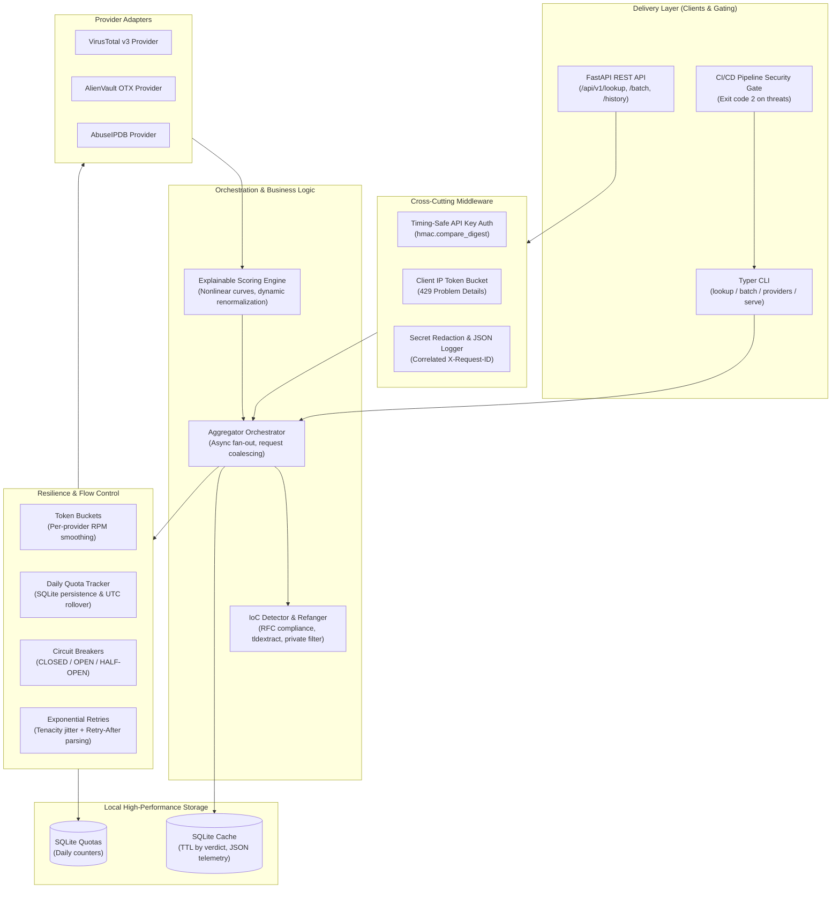
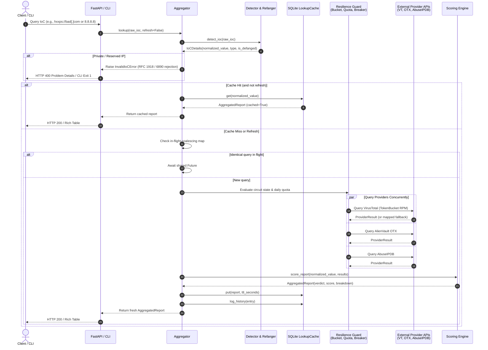

# ThreatLens Architecture & Design Decisions

This document outlines the system architecture, component boundaries, execution flows, and engineering trade-offs underpinning ThreatLens.

---

## 1. High-Level Component Architecture

ThreatLens is designed around clean hexagonal/ports-and-adapters architecture principles. The core business logic (IoC detection, provider aggregation, and explainable scoring) is completely decoupled from delivery mechanisms (FastAPI HTTP endpoints, Typer CLI) and persistence mechanisms (aiosqlite cache and quota storage).

---

## 2. Request Lifecycle & IoC Query Sequence

When an indicator is analyzed through either the REST API or the CLI, the following end-to-end flow executes:

---

## 3. Engineering Decisions & Architecture Trade-offs

### 3.1 Async I/O & Bounded Concurrency
- **Decision:** Use Python 3.11+ `asyncio` with `httpx.AsyncClient` rather than thread pools or synchronous requests.
- **Why:** Threat intelligence queries are fundamentally I/O bound. Concurrently querying 3-5 external HTTP APIs with latencies between 200ms and 1500ms would result in linear latency buildup ($O(N)$) in synchronous systems ($200ms + 500ms + 800ms = 1500ms$). Under async fan-out (`asyncio.gather`), total latency equals the slowest provider ($\max(200, 500, 800) = 800ms$).
- **Isolation:** Batch queries use `asyncio.Semaphore(concurrency)` to bound parallel in-flight connections (default 5, configurable up to 20), preventing descriptor exhaustion or self-inflicted network saturation.

### 3.2 Request Coalescing (Single-Flight Pattern)
- **Decision:** Implement in-flight deduplication via `_inflight: dict[str, asyncio.Future[AggregatedReport]]`.
- **Why:** Under sudden surges or batch ingestion (e.g., SIEM alerts alerting on the same IP 50 times across 10 seconds), without request coalescing, all 50 concurrent requests would experience a cache miss simultaneously (the "thundering herd" or "cache stampede" problem), exhausting free-tier provider quotas.
- **How:** The first request creates an uncompleted `asyncio.Future` in the in-flight dictionary. All subsequent concurrent requests for the exact same normalized IoC await that single Future. When the upstream call completes, the result is set on the Future, instantly satisfying all callers with zero redundant API calls.

### 3.3 SQLite with WAL Mode vs. Redis
- **Decision:** Built-in zero-dependency persistence using `aiosqlite` with SQLite Write-Ahead Logging (`PRAGMA journal_mode=WAL`).
- **Why:** ThreatLens is designed to be instantly runnable by hiring managers and security analysts without mandating external infrastructure services (Docker, Redis, PostgreSQL).
- **Performance:** SQLite in WAL mode permits concurrent readers without locking the writer. By using parameterized queries and indexes on `(ioc_hash)`, lookups achieve sub-millisecond latency.
- **TTL by Verdict:** Malicious indicators are cached for shorter durations (e.g. 2 hours) so remediations or sinkholing are promptly detected, while clean indicators are cached longer (24 hours) to preserve upstream quota.

### 3.4 Dual-Tier Rate Limiting & Flow Control
1. **Per-Minute Smoothing (Token Bucket):** Enforces upstream provider RPM (e.g. VirusTotal free tier: 4 requests/min) using an algorithmic token bucket with lazy fractional refill (`now - last_refill * rate`). If tokens are exhausted, the worker pauses (`asyncio.sleep`) up to a bounded maximum wait time.
2. **Daily Quotas (DailyQuotaTracker):** External APIs often have strict daily caps (e.g. VirusTotal: 500/day, AbuseIPDB: 1,000/day). In-memory counters would reset whenever the application restarts or reloads. Daily usage is tracked persistently in SQLite, keyed by `(provider, YYYY-MM-DD UTC)`. When the daily ceiling is reached, queries to that provider are gracefully skipped without crashing the pipeline.

### 3.5 Circuit Breaker Resilience
- **Decision:** Implement per-provider three-state circuit breakers (`CLOSED`, `OPEN`, `HALF_OPEN`).
- **Why:** If an external intelligence service experiences downtime, 5xx server errors, or persistent connection timeouts, continuing to flood it wastes local sockets and inflates user response times.
- **Behavior:** 5 consecutive failures trip the breaker to `OPEN`. For the next 60 seconds (recovery timeout), all requests to that provider are fast-failed without network calls. After the timeout, a probe request transitions the state to `HALF_OPEN`. A single success resets the circuit to `CLOSED`; a failure trips it back to `OPEN`.

### 3.6 Explainable Scoring with Dynamic Renormalization
- **Decision:** Transparent mathematical formulation instead of opaque machine-learning black boxes.
- **Mathematical Principle:**
  $$\text{Score} = \sum_{i \in \text{Available}} \left( \frac{w_i}{\sum_{j \in \text{Available}} w_j} \cdot \text{Subscore}_i \right)$$
- **Dynamic Renormalization:** If a provider is skipped due to lack of API key or circuit trip, its weight is not treated as zero score (which would artificially depress risk). Instead, the remaining available provider weights are dynamically renormalized to sum to 1.0, preserving score fidelity.
- **Explainability:** Every score calculation outputs a human-readable and machine-actionable `ScoreComponent` detailing the subscore, effective weight, mathematical contribution, and explicit rationale.
